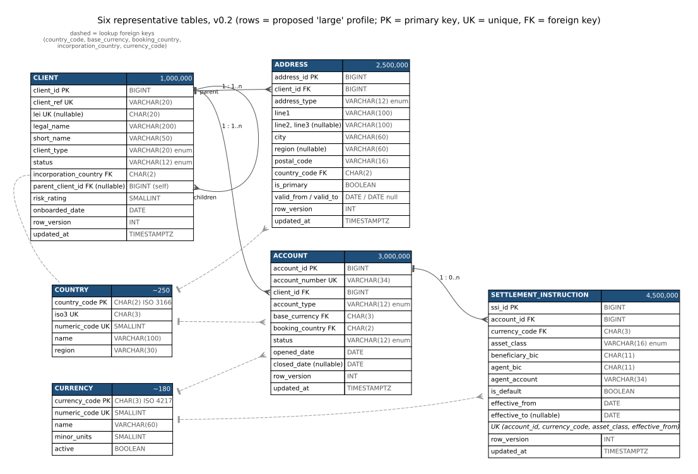
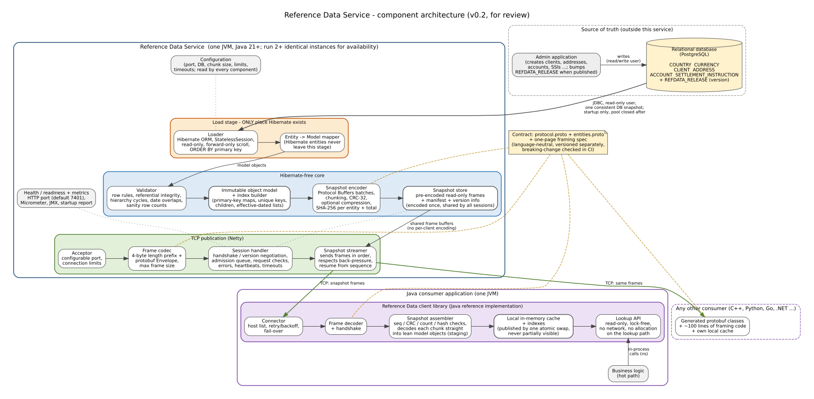
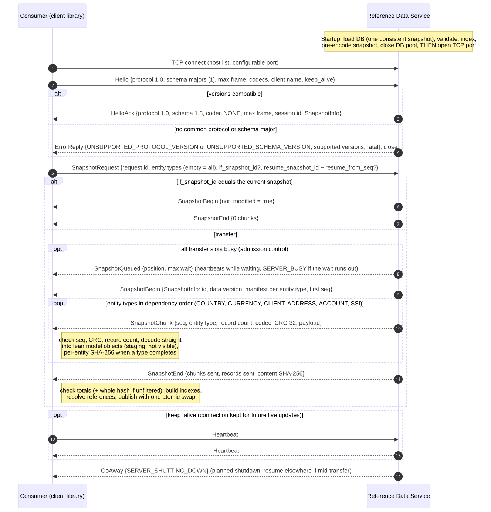

# 0. How to read this draft

* **What it is**: the technical and architectural requirements for a Java reference (static) data service and its consumers. Nothing has been built; the numbers marked *measured* come from small experiments on the draft contract, everything else marked *estimate* or *target* is to be proven by the reference implementation.
* **What to review first**: the component diagram (section 6), versioning (11), compatibility (12) and the error-handling tables (13). The decisions that need you are collected in section 19 and marked **[DECIDE]** where they arise.
* **Companion files** (same folder): `architecture.svg`, `data-model.svg`, `snapshot-sequence.svg` (full-size diagrams), `protocol.proto` and `entities.proto` (the draft wire contract; both compile).
* **Names**: error codes and entity types are written without their prefixes — SERVER_BUSY means `ERROR_CODE_SERVER_BUSY`, ACCOUNT means `ENTITY_TYPE_ACCOUNT`.

# 1. Purpose and scope

A Java **reference (static) data service** that loads a relational database once at startup, builds an indexed in-memory object model, and publishes a **full snapshot** over **TCP** to consumer applications. Consumers are low-latency, high-throughput servers: after startup they answer every reference-data lookup from **their own in-process memory**, never from the network or a database.

**In scope**

* Six representative tables, pre-populated with a large synthetic data set (about 11 million rows).
* Reference Data Service (server): load with Hibernate, validate, index, encode, publish over TCP.
* Language-neutral wire contract: length-prefixed frames carrying Protocol Buffers messages; the snapshot is sent as many chunks, not one message.
* A Java client library (the reference consumer), plus a small Python client to prove the protocol is language independent.
* Snapshot versioning, backward/forward compatibility rules, and error handling.

**Out of scope (for now)**

* Live updates / deltas. The data is assumed not to change while the service runs; new data means a restart. The protocol keeps room for updates (section 9.9) so they can be added without breaking anyone.
* The admin application itself (it owns writes to the database; this service only reads).
* Authentication and encryption on the TCP port — an open question (section 16, D-12).

# 2. Key decisions at a glance

| # | Decision | Choice | Why (short) |
|---|---|---|---|
| K1 | Runtime | Java 21 LTS as the minimum; Java 25 LTS recommended where the estate allows (**[DECIDE] D-15**) | Both are long-term-support releases; generational ZGC is available on both (on 21 it must be switched on explicitly, section 14.1). |
| K2 | Database loading | Hibernate ORM **StatelessSession**, read-only, forward-only scroll, isolated in one module | Meets "Hibernate may be used" without letting Hibernate types reach the model or the publisher. |
| K3 | In-memory model | Immutable Java objects + primitive-key indexes, built once | Lock-free reads, no allocation on lookup, safe sharing across threads. |
| K4 | Transport | Raw TCP, one configurable port, Netty on the server | Required by the brief; any language can open a socket. |
| K5 | Framing | 4-byte big-endian length prefix + one protobuf `Envelope` per frame | Trivial in any language; no varint framing quirks. |
| K6 | Encoding | Protocol Buffers (proto3), in two separately versioned files: protocol and entity schema | Best balance of language support, schema evolution and size for a once-per-start bulk transfer (section 10). |
| K7 | Snapshot delivery | Chunked: ~256 KiB frames, one entity type per chunk, dependency order | Bounded memory on both sides, smooth back-pressure, resumable. |
| K8 | Server encodes once | Snapshot frames are encoded at startup and the same bytes are written to every consumer | Per-client cost is only the network write; many consumers can load at once. |
| K9 | Versioning | Three independent versions: protocol, schema, data (snapshot) | Each changes for different reasons and at different rates (section 11). |
| K10 | Integrity | CRC-32 per chunk, SHA-256 per entity type and per snapshot, record counts in a manifest | A consumer never publishes a partial or corrupted cache; CRC-32 is in every language's standard zlib. |
| K11 | Consumer cache publication | Decode into a staging area, publish with one atomic reference swap | Application code never sees half a snapshot. |
| K12 | Database access after startup | None — the connection pool is closed once the snapshot is built | Enforces "static data" and removes the DB from the runtime picture. |

# 3. Functional requirements

| ID | Requirement |
|---|---|
| FR-1 | At startup the service loads all six tables from the relational database using Hibernate, from one consistent database snapshot. |
| FR-2 | The service validates the loaded data (mandatory fields, unique keys, referential integrity, hierarchy cycles, effective-date overlaps, sanity row counts) before publishing anything. |
| FR-3 | The service builds an immutable in-memory object model with primary-key and secondary indexes (section 8). |
| FR-4 | Publication to consumers does not depend on Hibernate: the publisher, the model and the wire contract have **no compile-time dependency** on Hibernate or JPA, enforced by the module graph and an architecture test (section 6.2). |
| FR-5 | The service listens on a configurable TCP port and only starts listening once the snapshot is ready. |
| FR-6 | A consumer connects, performs a version handshake and requests a full snapshot, or a subset of entity types. |
| FR-7 | The snapshot is sent as a sequence of frames (chunks) between a begin message (with a manifest) and an end message (with counts and hashes). |
| FR-8 | Any language that can open a TCP socket and decode Protocol Buffers can be a consumer; the contract is two `.proto` files plus a one-page framing spec. |
| FR-9 | An interrupted transfer can be resumed from the last good chunk, on the same or an identical service instance. |
| FR-10 | A consumer that already holds the current snapshot can ask "send only if different" and receive no data. |
| FR-11 | The Java client library builds the consumer's local cache and indexes and exposes a read-only lookup API with no network or database access. |
| FR-12 | The service exposes health/readiness and metrics on a separate HTTP port. |
| FR-13 | A data generator fills the six tables with a reproducible large data set at several scale profiles (section 5.3). |

# 4. Non-functional requirements (targets to be confirmed by benchmark)

These are **proposed targets**, not measurements of a working system; the reference implementation must measure each and report against it.

| ID | Quality | Proposed target at the "large" profile (≈11 M rows) |
|---|---|---|
| NFR-1 | Consumer lookup latency (by key, in process) | Zero allocation per lookup. Hot keys (working set in CPU cache): p50 < 50 ns. Keys spread uniformly over the whole data set: p50 < 300 ns, p99.9 < 2 µs on the target hardware. (Each cold lookup costs 2–3 memory accesses; a quick experiment on this desktop's VM measured 300–600 ns per dependent random lookup, ≈30 % less with large pages.) |
| NFR-2 | Lookup throughput | Scales with reader threads: no locks, no shared mutable state |
| NFR-3 | Determinism | No network, DB, lock or allocation on the lookup path; lookup cost independent of snapshot traffic |
| NFR-4 | Service startup (DB load + validate + index + encode) | < 2 minutes |
| NFR-5 | Consumer cold start (connect → verified, indexed, published cache) | < 60 seconds on a 10 Gb/s LAN |
| NFR-6 | Concurrent snapshot fan-out | ≥ 8 simultaneous full snapshots per instance, each within NFR-5 (network permitting, section 15.3) |
| NFR-7 | Availability | Two or more identical instances; consumers fail over via a host list. An instance restart does not affect consumers already running. |
| NFR-8 | Consumer memory | Full data set: live reference-data heap ≤ 3 GB (estimate 2.3–2.6 GB), peak during load ≤ 3.5 GB (section 15.2). Subset loads use proportionally less. |
| NFR-9 | Portability | Any JVM 21+ host or container; no OS-specific transport |
| NFR-10 | Observability | Every startup stage timed and counted; every session logged with client name, versions, bytes, duration and outcome |
| NFR-11 | Compatibility | A client built against schema 1.x works with any server serving 1.y, whether y is older or newer than x; checked in CI |

# 5. Data model

## 5.1 The six tables

The set mixes small lookup tables with large parent/child tables, so it exercises every index shape the real system will need: natural-key lookups, unique secondary keys, one-to-many children, a self-referencing hierarchy, a composite key and effective dating.

| Table | Rows (large profile) | Role in the design | Notable keys |
|---|---|---|---|
| COUNTRY | ~250 | Small lookup (ISO 3166) | PK country_code; UK iso3, numeric_code |
| CURRENCY | ~180 | Small lookup (ISO 4217) | PK currency_code; UK numeric_code |
| CLIENT | 1,000,000 | Legal entity / customer; parent-child hierarchy | PK client_id; UK client_ref; UK lei (nullable); FK incorporation_country; FK parent_client_id (self) |
| ADDRESS | 2,500,000 (avg 2.5 per client) | Typed, dated addresses | PK address_id; FK client_id; FK country_code |
| ACCOUNT | 3,000,000 (avg 3 per client) | Accounts of a client | PK account_id; UK account_number; FK client_id, base_currency, booking_country |
| SETTLEMENT_INSTRUCTION | 4,500,000 (avg 1.5 per account) | Where to settle, by currency and asset class, effective-dated | PK ssi_id; FK account_id, currency_code; UK (account_id, currency_code, asset_class, effective_from) |

* Each large table carries `row_version` and `updated_at`, written by the admin application. They are not needed for a static snapshot but are published so live updates can be added later without a schema change.
* `updated_at` is `TIMESTAMPTZ` and is always handled in UTC (`hibernate.jdbc.time_zone=UTC`, Java `Instant`); otherwise two service instances in different time zones would encode different bytes (section 9.8).
* **[DECIDE] D-1** Is SETTLEMENT_INSTRUCTION a good sixth table for your domain, or would CONTACT, PRODUCT/INSTRUMENT or another entity be more representative?
* **[DECIDE] D-13** Are the volumes (≈11 M rows at "large") realistic for your estate?

## 5.2 Data version table (recommended, outside the six)

`REFDATA_RELEASE (release_id BIGINT PK, status, published_at, description)` — the admin application inserts a row when it has finished a consistent set of changes. The service reads the latest PUBLISHED release id **inside the same database snapshot it loads from**, and publishes it as the snapshot's **data version**: a human-meaningful "which data am I running on" number and the future baseline for live updates.

The service loads whatever is committed; it cannot tell a finished release from half-entered admin edits. Operational precondition: the admin application is not in the middle of a release when the service starts.

**[DECIDE] D-2** Can the admin application maintain this table? If not, there is no data version: `data_version = 0` and the content hash (section 9.8) is the only identity. (`max(updated_at)` is not a reliable substitute — deletes do not change it.)

## 5.3 Pre-populated test data

* A **data generator** (separate module, never deployed with the service) writes the tables with PostgreSQL `COPY` for speed, not through the admin application.
* **Reproducible**: a fixed random seed produces the same rows every time, so benchmark runs are comparable and snapshot hashes are stable.
* **Realistic shape**: skewed distributions — averages of 2.5 addresses and 3 accounts per client and 1.5 SSIs per account, with most clients having 1–3 accounts and a few hundreds; about 10 % of clients in parent/child hierarchies up to 4 levels deep; 70 % of clients with an LEI; about 5 % closed accounts; realistic string lengths; SSIs and addresses with non-overlapping effective periods.
* **Scale profiles**: `tiny` (1 k clients, unit tests), `medium` (100 k clients, developer machines), `large` (1 M clients, ≈11 M rows, the reference benchmark), `xlarge` (5 M clients, stress/headroom).
* **Deliberately bad data** option: inject orphans, duplicates, overlaps, cycles and nulls into a copy, to test the validator (section 13.1).
* Schema (DDL) lives in versioned migration scripts (Flyway) in the repository; in production the admin application owns the schema.

Database: **PostgreSQL (16 or later)** is assumed for the reference implementation (free, runs in a container, fast bulk load). Only the consistent-read technique in 7.2 is PostgreSQL-specific. **[DECIDE] D-3** Which database does the real system use?

# 6. Component architecture

The diagram is wide; open `architecture.svg` (or click it) for full size.

## 6.1 Components

| Component | Responsibility | Key technology | Depends on |
|---|---|---|---|
| Configuration | All settings (section 16); validated at startup, logged without secrets | Typesafe Config or plain properties | — (read by every component) |
| Loader | Reads the six tables once, in primary-key order, read-only, from one consistent DB snapshot | Hibernate ORM StatelessSession, HikariCP, JDBC driver | Configuration, `RefDataSource` interface |
| Entity → model mapper | Converts each Hibernate row into an immutable model object as it streams; entities are never kept | Plain Java | Loader, Model |
| Validator | Row rules, referential integrity, hierarchy cycles, effective-date overlaps, sanity row counts; produces the validation report (duplicate keys are found by the index builder and reported here) | Plain Java | Model |
| Object model + index builder | Immutable records and indexes (section 8); frozen before publication | Java records, primitive collections (Agrona or Eclipse Collections) | — |
| Snapshot encoder | Turns the model into protobuf batches, cuts chunks, computes CRC-32 and SHA-256, optionally compresses | protobuf-java, LZ4/zstd | Model, Contract |
| Snapshot store | Holds the encoded read-only frames, the manifest and version info for the life of the process | Java heap byte arrays wrapped once as read-only Netty buffers | Encoder |
| Acceptor | Listens on the configured port, enforces the connection limit | Netty | Configuration |
| Frame codec | Length-prefix framing, frame size limits, Envelope encode/decode | Netty `LengthFieldBasedFrameDecoder` | Contract |
| Session handler | Handshake and version negotiation, admission queue, request validation, errors, heartbeats, timeouts; one state machine per connection | Netty | Snapshot store (snapshot info), Configuration |
| Snapshot streamer | Writes the requested frames in order, respects TCP back-pressure, supports resume and subsets | Netty channel writability | Snapshot store |
| Health / metrics | Liveness, readiness, metrics, startup report on a separate HTTP port | Micrometer (Prometheus), JMX | All |
| Contract | `protocol.proto`, `entities.proto` + framing spec; versioned, breaking-change checked | protobuf, buf | — |
| Java client library | Connector, frame decoder, snapshot assembler/verifier, local cache + indexes, lookup API | Plain blocking socket is enough (startup only) | Contract, Model |

Snapshot frames are held as **heap** byte arrays so that all memory is inside `-Xmx` and `-XX:+ExitOnOutOfMemoryError` covers it. Each frame is wrapped once as a read-only buffer that can never be released (`Unpooled.unreleasableBuffer(Unpooled.wrappedBuffer(bytes).asReadOnly())`), and each session writes its own `duplicate()` of it, so one session can never disturb another's bytes. Netty copies each heap frame into a pooled direct buffer when writing; if the fan-out benchmark shows that copy matters, the frames can move to direct memory (then sized with `-XX:MaxDirectMemorySize`, see 15.2 and S-13).

## 6.2 Module layout (Maven multi-module) and the Hibernate boundary

| Module | Contents | Allowed dependencies |
|---|---|---|
| `refdata-contract` | `refdata/protocol/v1/protocol.proto`, `refdata/schema/v1/entities.proto`, generated Java classes, framing constants | protobuf-java |
| `refdata-model` | Immutable domain records, index structures, lookup interfaces, and the `RefDataSource` interface (returns model objects) | primitive-collections library only |
| `refdata-loader-hibernate` | JPA entities, Hibernate loader, entity → model mapper; implements `RefDataSource` | refdata-model, Hibernate, JDBC driver |
| `refdata-server` | Validator, encoder, snapshot store, Netty server, health/metrics | refdata-model, refdata-contract (**no** Hibernate) |
| `refdata-app` | The launcher (`main`): wires `refdata-loader-hibernate` into `refdata-server` | refdata-server, refdata-loader-hibernate |
| `refdata-client` | Java client library | refdata-model, refdata-contract |
| `refdata-datagen` | Test data generator and DDL migrations | JDBC, Flyway |
| `refdata-conformance` | Golden frame recordings + harness any-language clients run against; Python sample client | — |
| `refdata-bench` | JMH benchmarks, load and soak tests | all |

"Publication is independent of Hibernate" is **enforced by the build**: only `refdata-loader-hibernate` and the thin launcher see Hibernate; an ArchUnit test fails the build if any class outside `refdata-loader-hibernate` imports `org.hibernate` or `jakarta.persistence`. The same interface lets a plain JDBC loader replace Hibernate later, with nothing else changing.

The **same `refdata-model` module is used by the server and the Java client**, so index semantics are identical on both sides.

# 7. Service startup lifecycle

## 7.1 Sequence

1. Read and validate configuration (including cross-checks such as chunk size vs frame size, section 9.5); log the effective configuration without secrets.
2. Connect to the database with a **read-only** user and open the consistent read (7.2).
3. **Pre-flight**: `COUNT(*)` per table and the data version from REFDATA_RELEASE, both inside the consistent read; estimate the heap needed (section 15.2); fail fast if the heap is too small or a table is below its sanity minimum.
4. **Load** the six tables in parallel (one connection per large table, all in the same database snapshot), mapping rows to model objects as they stream.
5. **Validate** (section 13.1, S-5, S-7, S-8, S-14). Default policy: any error fails startup. **[DECIDE] D-4** Alternative: "quarantine" — exclude bad rows (and their dependants), report them, publish the rest.
6. **Build indexes** (duplicate unique keys are detected here, S-6), pre-sized from the row counts, then resolve references (for example Account → Client) and freeze the model.
7. **Encode** the snapshot: protobuf batches, chunks, CRC-32, per-entity and total SHA-256, manifest, content-derived snapshot id. Optionally pre-compress.
8. **Close the database pool.** From here on the service has no database dependency.
9. Write the startup report (row counts, timings, memory, hashes, data version, validation summary) to the log and the health endpoint.
10. **Open the TCP port**; readiness becomes UP.

Until step 10 the port is not listening, so a consumer simply gets "connection refused" and tries the next instance or retries. There is no "not ready" state on the wire.

## 7.2 Loading with Hibernate

* Entities are annotated `@Immutable` and map foreign keys as **plain ids** (no `@ManyToOne`), so there are no joins, no lazy proxies and no N+1 queries. A constructor/tuple projection is an option if per-row overhead shows up in measurements.
* `StatelessSession` (no persistence context, so memory does not grow with row count), `ScrollMode.FORWARD_ONLY`, JDBC fetch size ≈10,000, `ORDER BY` primary key (deterministic output → stable hashes).
* PostgreSQL only streams with a fetch size when auto-commit is **off**; each loader must run inside a read-only transaction, or the driver reads the whole table into memory.
* Second-level cache and query cache off; statistics on (logged).
* **Consistent read across parallel loaders (PostgreSQL)**: a coordinator transaction at REPEATABLE READ calls `pg_export_snapshot()` and **stays open** until every loader has executed `SET TRANSACTION SNAPSHOT` (so the connection pool needs loaders + 1 connections). Each loader transaction is REPEATABLE READ and runs `SET TRANSACTION SNAPSHOT '<id>'` as its **first statement** (with Hibernate: `session.doWork(...)` right after `beginTransaction()`, before any query). The pre-flight counts and the REFDATA_RELEASE read happen in the coordinator, so the data version always matches the rows loaded. Databases without snapshot export load sequentially in one transaction.
* Hibernate vs plain JDBC speed is measured early (NFR-4 is 2 minutes); the `RefDataSource` interface keeps the choice reversible.

# 8. In-memory object model and indexes

## 8.1 Object model principles

* **Immutable** objects (Java records or final classes), published once through a `volatile` reference; readers need no locks.
* **Resolved references** in addition to ids: `account.client()` returns the Client object directly — one pointer dereference, not a map lookup. References are resolved in a pass after all records have arrived (a client's parent may have a higher id than the client).
* **Low-cardinality values are shared**, not duplicated: country and currency become references to the single Country/Currency object; enum columns become Java enums (each with an explicit `UNKNOWN` constant for values from a newer schema); repeated strings such as city, region and BIC codes are de-duplicated during the build. This is the biggest single memory saving.
* **Optional values**: optional numeric columns use a documented sentinel (for example `NO_PARENT = 0`) with an accessor such as `hasParent()`; optional strings are `null`.
* **Allocation-free access to children**: one-to-many relations are stored in compact arrays (8.2); the API exposes them by count and position (`countOfClient(clientId)`, `ofClient(clientId, i)`), which allocates nothing. A convenience `List` view is also offered and documented as allocating (for non-hot-path code).

## 8.2 Indexes

| Entity | Index | Kind | Structure (proposed) | Typical consumer question |
|---|---|---|---|---|
| Country | country_code | unique | 26×26 array indexed by the two letters (codes validated as A–Z) | "Country for GB" |
| Country | iso3, numeric_code | unique | small hash map / 1000-slot array | Conversions from other feeds |
| Currency | currency_code | unique | 26³ array indexed by the three letters (codes validated as A–Z) | "Minor units for JPY" |
| Currency | numeric_code | unique | 1000-slot array | ISO numeric from FIX/SWIFT |
| Client | client_id | primary | dense array by id if ids are dense, else open-addressing long → object map | "Client 123456" |
| Client | client_ref | unique | custom open-addressing map over ASCII bytes (see notes) | Lookups by external code |
| Client | lei | unique, sparse | same | Regulatory reporting |
| Client | parent_client_id | one-to-many (children) | offsets + children arrays (CSR); `ultimateParent()` pre-computed | Group exposure, hierarchy walk |
| Address | address_id | primary | long → object map | — |
| Address | client_id | one-to-many | CSR, children sorted by type, then valid_from | "All addresses of client" |
| Address | (client_id, address_type) → primary address **on a date** | effective-dated | per (client, type) a short array sorted by valid_from; binary search by date | "Registered address of client today" |
| Account | account_id | primary | dense array or long → object map | "Account 987" |
| Account | account_number | unique | custom open-addressing map over ASCII bytes | Incoming messages carry account numbers |
| Account | client_id | one-to-many | CSR | "All accounts of client" |
| SSI | ssi_id | primary | long → object map | — |
| SSI | account_id | one-to-many | CSR, sorted by currency, asset class, effective_from | "All SSIs of account" |
| SSI | (account_id, currency, asset_class) → default SSI **on a date** | effective-dated | packed long key → short array sorted by effective_from; binary search by date | "Where do I settle EUR cash for account 987 today?" |

Notes for review:

* **Effective dating**: consumers run for days without updates, so "current" cannot be fixed at build time. Both effective-dated indexes take the date as a parameter; the validator guarantees at most one default SSI / one primary address per key on any date (S-14).
* **Primitive keys, no boxing**: `long` keys are never boxed; maps use open addressing with parallel `long[]`/`Object[]` arrays (Agrona `Long2ObjectHashMap` or Eclipse Collections `LongObjectHashMap`), pre-sized from the manifest/row counts so they never resize. **[DECIDE] D-5** Library choice; both are fine, Agrona is smaller.
* **String keys** (client_ref, lei, account_number) are looked up by consumers that usually hold bytes from a message, not a `String`. Stock maps compare with `equals` and would need a `String` per lookup, so these use a small **custom open-addressing map** hashing the ASCII bytes, with lookups by `CharSequence` or by `(buffer, offset, length)` — no allocation.
* **Composite key packing**: `key = account_id << 19 | currencyLetters << 4 | assetClass`, where currencyLetters packs the three A–Z letters of the ISO code into 15 bits (so the key does not depend on the CURRENCY table being loaded) and account_id < 2^45 (a validator rule; otherwise a two-level index is used). The client library always loads COUNTRY and CURRENCY (a few hundred rows) even when a subset is requested, because other entities refer to them.
* **CSR ("compressed sparse row") form**: one `int[]` of offsets indexed by the parent's position, plus one array of all children; no per-parent objects, cache-friendly, about 4 bytes per child.
* Dense arrays are chosen automatically when `max_id / row_count` is below a threshold (`rds.index.dense.threshold`, default 1.5), otherwise hash maps.
* Dates are stored as `int` epoch days; "effective on date D" compares ints.

## 8.3 Consumer lookup API (shape only, for review)

~~~java
RefDataClient rds = RefDataClient.builder()
        .endpoints("rds-a:7400", "rds-b:7400")     // host list, tried in order with back-off and jitter
        .clientName("order-router")
        .entityTypes(EntityType.ALL)               // or a subset, e.g. ACCOUNT + SETTLEMENT_INSTRUCTION
                                                   // (COUNTRY and CURRENCY are always loaded)
        .startupTimeout(Duration.ofMinutes(3))
        .build();

RefData data = rds.load();                          // blocks: handshake, stream, verify, index, publish

Client c   = data.clients().byId(123456L);              // null if absent; no allocation
Account a  = data.accounts().byNumber(buf, off, len);   // bytes straight from the incoming message
int n      = data.accounts().countOfClient(123456L);    // children by position, no allocation
Account a0 = data.accounts().ofClient(123456L, 0);
Ssi s      = data.ssis().defaultFor(a.id(), eur, AssetClass.CASH, todayEpochDay);
SnapshotInfo v = data.snapshotInfo();                    // data version, snapshot id, schema version
~~~

# 9. Wire protocol

## 9.1 Transport

* Plain TCP on one configurable port (default proposed **7400**; the number is arbitrary). `TCP_NODELAY` on.
* Socket buffer sizes are left to the kernel's auto-tuning by default: setting them explicitly on Linux switches auto-tuning off for that socket and is capped by `net.core.wmem_max`/`rmem_max`. Optional settings exist (`rds.tcp.send.buffer`), and the effective values are logged.
* One connection carries one session; a session performs at most one snapshot transfer at a time.
* Server threading: Netty with 1 acceptor thread and N I/O threads (`rds.io.threads`, default = cores). Frames are pre-encoded, so I/O threads do no encoding work.

## 9.2 Framing

~~~
+---------------------------+-------------------------------------------+
| length : uint32, big-end. | Envelope (protobuf), exactly length bytes |
+---------------------------+-------------------------------------------+
~~~

* `length` excludes the 4-byte prefix. `0` or more than the receiver's limit is a protocol violation and the connection is closed.
* Every frame body is one `Envelope` whose `oneof body` says what it is (Hello, SnapshotChunk, ErrorReply …).
* A fixed 4-byte prefix is used instead of protobuf's varint "delimited" helpers because every language can read four bytes, and some protobuf libraries do not expose the varint helpers.
* **Limits**: the server never sends a frame larger than `rds.frame.max.bytes` (default 1 MiB); a client must accept at least that. Chunk frames are fixed at startup, so a client whose `Hello.max_frame_bytes` is smaller than the largest chunk frame is rejected with FRAME_TOO_LARGE (P-7). `max_frame_bytes = 0` means "not stated" = 1 MiB. The server's limit for frames it *receives* is a separate small constant (64 KiB): clients only send small control messages.
* A non-protocol client is rejected at once: an HTTP request's first four bytes ("GET ") read as a length of ≈1.2 billion, a TLS hello as ≈370 million.
* **Frozen forever** (all protocol majors): the framing, Envelope fields 1, 2 and 8, the first fields of Hello, HelloAck and ErrorReply, and the error codes that can be sent before or during the handshake (PROTOCOL_VIOLATION, UNSUPPORTED_PROTOCOL_VERSION, UNSUPPORTED_SCHEMA_VERSION, HANDSHAKE_TIMEOUT, SERVER_BUSY, FRAME_TOO_LARGE) — listed in `protocol.proto`. That is what lets any old client and any new server at least agree that they disagree.

## 9.3 Message set

Defined in `protocol.proto` (draft, compiles). Direction: C = client, S = server.

| Message | Direction | Purpose |
|---|---|---|
| Hello | C→S | First frame. Protocol version, supported schema majors, max frame size, client name/instance/library version, accepted codecs, keep-alive wish |
| HelloAck | S→C | Chosen protocol/schema version and codec, max frame size, session id, heartbeat interval, description of the current snapshot |
| SnapshotRequest | C→S | Request id; optional entity-type filter; optional "only if different from snapshot id X"; optional resume point |
| SnapshotQueued | S→C | The request waits for a transfer slot: queue position and maximum wait |
| SnapshotBegin | S→C | Snapshot info and manifest (per entity type: record count, first chunk number, chunk count, bytes, hash); the types actually being sent; first chunk of this response |
| SnapshotChunk | S→C | One chunk: sequence number, entity type, record count, codec, uncompressed size, CRC-32, payload (one serialized batch of one entity type) |
| SnapshotEnd | S→C | Totals for the transfer and the whole-snapshot SHA-256 |
| Heartbeat | S→C while queued; both directions on kept-alive connections | Liveness while a connection waits or idles |
| ErrorReply | both | Error code, message, fatal flag, retry hint, supported version ranges. Clients send it only to report an integrity failure (INTEGRITY_FAILURE) before closing |
| GoAway | S→C | Planned shutdown; reconnect to another instance |

## 9.4 Conversation

Server session states: `AWAIT_HELLO → READY → (QUEUED →) STREAMING → READY …`

* The client must wait for HelloAck before sending SnapshotRequest. The server treats anything before Hello, or a second Hello, as a protocol violation. A client may send ErrorReply (INTEGRITY_FAILURE) in any state and then closes.
* A second SnapshotRequest while one is queued or streaming is rejected with a non-fatal INVALID_REQUEST.
* A session in READY with no request for `rds.session.idle.timeout` (default 60 s) is closed with IDLE_TIMEOUT, unless it asked for keep-alive, in which case heartbeats apply. Without keep-alive, the **client** closes the connection after SnapshotEnd.
* HelloAck always carries the heartbeat interval. While QUEUED the server sends heartbeats (the client does not need to), so the client can tell "waiting" from "dead"; the client's read timeout must be longer than 3 × that interval, and its overall `startupTimeout` longer than `rds.snapshot.queue.max.wait`. A request answered with `not_modified` never waits in the queue.

## 9.5 Chunking rules

* A chunk contains records of **one entity type only**, in primary-key order.
* Chunk **target size 256 KiB uncompressed** (`rds.chunk.target.bytes`, configurable 64–960 KiB). The chunker closes a chunk before adding a record would push the whole frame over `rds.frame.max.bytes`; startup fails (S-1) unless the frame limit ≥ chunk target + 64 KiB. With the measured record sizes a chunk holds about 2,600–4,400 records; the large profile has about 3,200 chunks; framing overhead is about 0.01 %.
* Entity types are sent in **dependency order**: COUNTRY, CURRENCY, CLIENT, ADDRESS, ACCOUNT, SETTLEMENT_INSTRUCTION.
* `seq` is the chunk's position in the **full** snapshot (from 0). A filtered request receives only the ranges of the requested types, which the manifest lists, so the client always knows which `seq` comes next.
* Entity types the server does not know (requested by a newer client) are **ignored, not rejected**; SnapshotBegin lists the types actually being sent and the client decides whether a missing type is fatal for it.
* Chunk frames contain **no session-specific fields**, which is what allows them to be encoded once and written unchanged to every consumer.
* The payload is one serialized `<Entity>Batch`. Concatenating serialized batches of the same type gives exactly the bytes of one big batch (checked by experiment), so the per-entity hash does not depend on where chunk boundaries fall.

## 9.6 Flow control, slow consumers and admission

* The streamer writes frames while the channel is writable and pauses when the channel's write buffer passes its high-water mark, resuming at the low-water mark. This service sets them to 8 MiB / 4 MiB (`rds.write.buffer.high.water` / `low.water`; Netty's own default is only 64 KiB / 32 KiB). TCP flow control then paces the server to the consumer; nothing is buffered without bound.
* No application-level credit scheme is needed for a one-way bulk transfer.
* **Slow-consumer protection**: no write progress for `rds.stall.timeout` (default 30 s), or a transfer longer than `rds.snapshot.max.duration` (default 10 min) → the server closes the connection.
* **Admission control**: at most `rds.max.concurrent.snapshots` (default 8) transfers run at once. Further requests are QUEUED (SnapshotQueued sent, bounded queue `rds.snapshot.queue.size` = 64, wait up to `rds.snapshot.queue.max.wait` = 60 s); beyond that, SERVER_BUSY with a retry-after hint. This protects the network link so each admitted consumer gets a predictable transfer time.

## 9.7 Integrity checks (consumer side)

| Check | When | On failure |
|---|---|---|
| Frame length ≤ negotiated maximum | every frame | fatal protocol error, reconnect |
| `seq` is exactly the next expected number | every chunk | close, resume from the last good chunk on a new connection |
| CRC-32 of payload (zlib's CRC-32: in the standard library of Java, Python and Go, a common zlib or package dependency in C++ and .NET; hardware-assisted in Java) | every chunk | report INTEGRITY_FAILURE to the server, close, resume on a **different** host if there is one (C-3) |
| Decoded record count = `record_count` | every chunk | as CRC failure |
| Per-entity SHA-256 and record count | when the last chunk of a type arrives | discard staging, full restart (C-4) |
| Totals: the chunks and records the client itself accepted vs the manifest (for the requested types) and vs SnapshotEnd's `chunks_sent`/`records_sent` | SnapshotEnd | full restart (C-4) |
| Whole-snapshot SHA-256 (= SHA-256 over the per-entity hashes in manifest order) | SnapshotEnd, **unfiltered requests only** | full restart (C-4) |

Only after every check passes does the client build indexes and publish the cache with one atomic swap. A filtered request checks the per-entity hashes of the types it received; it can still recompute the whole-snapshot hash from the manifest if it wants to confirm the manifest itself.

## 9.8 Snapshot identity, resume and "send only if different"

* **Snapshot id is content-derived**: the first 16 bytes of SHA-256 over (schema version, chunk layout, whole-snapshot hash). Two instances that loaded the same data with the same build and settings produce the **same id and byte-identical chunks**.
* Determinism requires: `ORDER BY` primary key, UTC timestamps, the same protobuf and compression library versions, the same chunk settings. A build or settings change produces a new id, which is harmless (only resume and "send only if different" use it).
* **Resume rules**:
  1. The client keeps its staging area and its running per-entity hash state across connections, and only hashes a chunk after its CRC and record count have passed.
  2. It reconnects (same or another host), repeats the handshake, and sends a SnapshotRequest with `resume_snapshot_id` (non-empty = this is a resume), `resume_from_seq` = the first chunk it has not yet accepted, and **the same** entity filter as before.
  3. If that instance serves the same id, it answers with SnapshotBegin (same snapshot info, `first_seq` = the resume point) and continues. Otherwise SNAPSHOT_NOT_AVAILABLE, and the client discards its staging area and starts again from zero.
  4. A resume point outside the requested ranges is INVALID_REQUEST.
  5. SnapshotEnd totals always cover the whole transfer, including chunks received before the resume.
* **Send only if different**: a consumer that persisted a verified snapshot locally (optional feature, **[DECIDE] D-7**) sends `if_snapshot_id`; if it matches, the server answers SnapshotBegin with `not_modified = true`, then SnapshotEnd, and sends no chunks.

## 9.9 Room for the future (live updates)

Envelope field numbers 11–99 are kept free (deliberately not declared `reserved`, which in protobuf would mean "never use") for future control and update messages. `row_version` and `updated_at` are already published, and keep-alive connections with heartbeats already exist. Updates can therefore be added as a **minor** protocol version: clients that do not ask for them never receive them.

# 10. Encoding: why Protocol Buffers

The snapshot is transferred **once per consumer start** and then converted into the consumer's own object model. The latency-critical part — the local lookup — involves no encoding at all. So the format should be chosen for language support, schema evolution and reasonable size, not for nanosecond decoding.

| Option | Language support | Schema evolution | Size | Decode speed | Verdict |
|---|---|---|---|---|---|
| **Protocol Buffers (proto3)** | Excellent (official: Java, C++, C#, Go, Python, …) | Very good, well-known rules, tool-checked (`buf breaking`) | Compact (varints) | Good | **Recommended** |
| SBE (Simple Binary Encoding) | Java, C++, C#, Go, Rust (community) | Limited (append-only, fixed layout) | Compact, fixed size | Fastest | Better for hot-path market-data messages than for a variable-string bulk snapshot |
| FlatBuffers / Cap'n Proto | Good | Good | Larger (alignment, offsets) | Zero-copy access | Attractive only if consumers used the buffer itself as their cache; they don't (they need indexes) |
| Avro | Good (JVM-centred) | Good, but needs the writer's schema at read time | Compact | Moderate | Extra schema-registry machinery for no gain here |
| JSON | Universal | Loose | 3–5× larger | Slow | Not suitable at 11 M rows |

Conclusion: **keep Protocol Buffers**. Consumers decode each chunk straight into their own lean model and drop the generated protobuf objects (which are larger and carry parsing baggage).

Transport alternative worth noting: **gRPC server-streaming** would give framing, flow control and multi-language clients for free, but adds HTTP/2 and a larger dependency footprint on every consumer, and makes shared pre-encoded frames harder. The brief asks for a plain TCP port, so this design uses raw TCP. **[DECIDE] D-8** Confirm raw TCP over gRPC.

# 11. Versioning

Three versions change independently and for different reasons:

| Version | What it covers | Where it lives | Changes when | Negotiation |
|---|---|---|---|---|
| **Protocol version** | Framing and control messages (Hello, chunks, errors …) | package `refdata.protocol.v1` (`protocol.proto`); `protocol_major.minor` in Hello/HelloAck | Major: conversation changes incompatibly. Minor: new optional messages or fields | The client states its major; the server accepts it if it is within the range it supports (e.g. 1–2); minor differences are always compatible |
| **Schema version** | The entities (Client, Account …) and the list of entity types | package `refdata.schema.v1` (`entities.proto`) = major; `schema_minor` announced in HelloAck | Major: breaking entity change. Minor: additive fields, new entity types, new enum values | Client lists the majors it understands; server picks the highest common one; none → UNSUPPORTED_SCHEMA_VERSION |
| **Data (snapshot) version** | The data content | `data_version` (release id), `snapshot_id` (content-derived), `content_sha256`, `built_at` | Every restart on changed data | Informational; used for "send only if different", resume, cross-instance consistency and audit |

Because the two `.proto` files are separate packages and the protocol file never imports the entity schema (entity types travel as plain numbers, payloads as bytes), a schema major can change without touching the protocol, and vice versa.

Rules:

* A server may serve **two schema majors side by side** during a migration window (for example v1 and v2). Each served major costs one more copy of the encoded snapshot (about 0.8 GB at the large profile) — an explicit, temporary cost.
* **Deprecation policy** (proposed): an old schema or protocol major is served for at least 6 months after its successor ships; the server logs and counts every session still using it, so owners can be chased. **[DECIDE] D-9** Window length.
* Every consumer logs the versions it negotiated and the snapshot it loaded, and exports them as metrics; the server logs the same per session. "Who is on what" is answerable from metrics.
* **Different data on different instances**: after a database change and a rolling restart, instance A may serve release N while B serves N+1, and consumers would split between them. Instances that loaded the same data report the same `content_sha256`; a difference raises an alert. Proposed policy: operations restart all instances before consumers; the client library offers `expectedDataVersion` / `minDataVersion` options that reject a mismatching instance and try the next host. **[DECIDE] D-14** Is that enough, or must consumers be prevented from mixing versions automatically?

# 12. Backward and forward compatibility

## 12.1 Rules for changing the contract

| Change | Allowed within a major? | What old readers see | Notes |
|---|---|---|---|
| Add an optional field to an entity | Yes (schema minor) | Unknown field, ignored | New readers must cope with it being absent from old servers |
| Add a new entity type | Yes (schema minor) | Chunks of an unknown type are **skipped** (still checked for seq and CRC; counted, logged once) | The manifest tells old clients exactly which chunks to skip |
| Add an enum value | Yes (schema minor) | Java's generated enum returns `UNRECOGNIZED` (the number is kept); the client library maps it to the model enum's `UNKNOWN` and never fails | Business rules must treat UNKNOWN fail-safe (an account with UNKNOWN status is not ACTIVE). A new value that changes business decisions is a semantic change — review checklist |
| Add a new control message | Yes (protocol minor) | Envelope parses with no known body → non-fatal UNSUPPORTED_MESSAGE | Only sent to peers that announced support |
| Rename a field | Yes, wire-safe | Nothing (binary uses numbers) | Breaks source code of consumers when they regenerate → listed in release notes |
| Remove a field | Only via `deprecated` first, then `reserved` number and name after the deprecation window | Old readers get the default value | Never reuse the number or name |
| Change a field's type or number | **No** — new major | — | e.g. `int32` → `int64` = new field + deprecate the old one |
| Change a field's meaning | **No** — new major | — | Semantic breaks are the hardest to detect; review checklist item |
| Change framing or the frozen handshake fields | **Never** | — | Section 9.2 |

## 12.2 Compatibility matrix (what must work)

| Client \\ Server | Server older (schema 1.2) | Server same (1.3) | Server newer (1.4) | Server next major only (2.0) |
|---|---|---|---|---|
| Client 1.3 | Works; fields added in 1.3 are absent (defaults); entity types added in 1.3 are not sent (SnapshotBegin says so) | Works | Works; new fields and entity types ignored, new enum values → UNKNOWN | Rejected cleanly: UNSUPPORTED_SCHEMA_VERSION (servers should also offer 1.x during the window) |
| Client supporting [1, 2] | Works on v1 | Works on v1 | Works on v1 | Works on v2 |

## 12.3 Enforcement

* `buf lint` and `buf breaking --against <last release>` run in CI with the **WIRE** rule category (binary compatibility, which is what consumers depend on; the stricter default category would reject the renames and reserved removals that 12.1 allows). A wire-breaking change fails the build unless the package major is bumped.
* **Golden snapshots**: a recorded frame stream from every released server version is kept; every new client version must load all of them. Every new server version must be loaded by the previous two released client versions (kept as test artifacts).
* The conformance kit (golden recordings + expected counts and hashes) is what non-Java client owners run to prove their implementation.

# 13. Error handling

Severity: **Fatal** = the process or session cannot continue; **Error** = the operation fails and is retried; **Warn** = logged and counted, processing continues.

## 13.1 Service startup and data

| # | Scenario | Detected by | Behaviour | Severity | Operator / client sees |
|---|---|---|---|---|---|
| S-1 | Invalid or missing configuration, or inconsistent settings (e.g. chunk target too big for the frame limit) | Configuration | Exit non-zero before any work; message names the key | Fatal | Log; orchestrator shows failure |
| S-2 | Database unreachable / login fails | Loader | Retry with exponential back-off (`rds.db.connect.retries`, default 5 over ≈2 min), then exit non-zero | Fatal after retries | TCP port never opens; readiness DOWN; consumers use other instances |
| S-3 | Configured heap too small for the pre-flight estimate | Pre-flight | Exit with required vs available memory | Fatal | Clear message instead of a late OutOfMemoryError |
| S-4 | Query fails or times out mid-load | Loader | Abort the whole load (no partial model), retry the full load (`rds.load.retries`, default 2), then exit | Error → Fatal | Startup report names table and cause |
| S-5 | Mandatory column null, value out of range, unknown enum code, country/currency code not A–Z | Validator | Default: fail startup, listing the first 100 offending rows and counts. Option (D-4): quarantine | Fatal (or Warn) | Validation report in log and on the health endpoint |
| S-6 | Duplicate value in a unique key (e.g. account_number) | Index builder | Fail startup: an ambiguous unique index cannot be published | Fatal | Report lists duplicates |
| S-7 | Orphan foreign key (account → missing client) | Validator | Default: fail. Option (D-4): quarantine the orphan and its dependants | Fatal (or Warn) | Counts per relation |
| S-8 | Cycle in the client parent hierarchy | Validator | Fail (hierarchy walks must terminate) | Fatal | Report lists the cycle |
| S-9 | Table empty or below its sanity minimum (e.g. truncated DB) | Pre-flight | Fail rather than publish near-empty data | Fatal | Expected minimum vs actual |
| S-10 | Consistent read cannot be established (snapshot export fails or the coordinator transaction ends early) | Loader | Retry once, then fall back to sequential loading in one transaction (slower, still consistent) | Warn | Log notes the fallback and the extra time |
| S-11 | A single record larger than the frame limit | Encoder | Fail startup (it could never be sent) | Fatal | Log names the record |
| S-12 | TCP port already in use | Acceptor | Exit non-zero | Fatal | Log |
| S-13 | Out of memory | JVM | Heap: `-XX:+ExitOnOutOfMemoryError`, orchestrator restarts. Direct memory (Netty's per-session write buffers — up to about the 8 MiB high-water mark per transferring session, ≈64 MiB for 8 transfers — and all frames if they are ever moved off-heap) is **not** covered by that flag: it is bounded by the water marks and `-XX:MaxDirectMemorySize` (≥ 256 MiB); an allocation failure closes the session (P-16) | Fatal / Error | Alert. Heap dumps off by default (they contain client data, D-12) |
| S-14 | Overlapping effective periods: more than one default SSI for (account, currency, asset class), or more than one primary address of a type, on the same date | Validator | Fail (or quarantine, D-4): the effective-dated lookups must have one answer per date | Fatal (or Warn) | Report lists the overlaps |
| S-15 | Composite key out of range (account_id ≥ 2^45) | Index builder | Use the two-level index instead of the packed key | Warn | Log; slightly slower lookups for that index |
| S-16 | Stored frame fails its own CRC re-check (after a client's INTEGRITY_FAILURE report, or a periodic check) | Snapshot store | Mark the instance not ready, stop accepting new transfers, exit for a clean restart | Fatal | Alert: memory corruption or a buffer-handling bug |

## 13.2 Connection and protocol (server side)

| # | Scenario | Detected by | Behaviour | Code sent | Fatal? | Client action |
|---|---|---|---|---|---|---|
| P-1 | Consumer connects before the service is ready | — | Port not listening yet | — (connection refused) | — | Next host; back-off with jitter |
| P-2 | Connection limit reached | Acceptor | Send error (before Hello — why ErrorReply's first fields are frozen) and close | SERVER_BUSY + retry_after_ms | Yes | Wait the hint (with jitter) or next host |
| P-3 | No Hello within `rds.handshake.timeout` (10 s) | Session | Close | HANDSHAKE_TIMEOUT | Yes | Reconnect; bug if repeated |
| P-4 | Frame length 0 or over the limit, bytes that do not parse as an Envelope, or a message in the wrong order (e.g. SnapshotRequest before Hello, a second Hello) | Frame codec / session | Close | PROTOCOL_VIOLATION or FRAME_TOO_LARGE | Yes | No tight retry loop; alert (client bug or wrong port) |
| P-5 | Protocol major 0 or not supported | Session | Close | UNSUPPORTED_PROTOCOL_VERSION + supported range | Yes | Fail startup: upgrade the client library |
| P-6 | No common schema major | Session | Close | UNSUPPORTED_SCHEMA_VERSION + supported majors | Yes | Fail startup: upgrade client or server |
| P-7 | Client's max frame smaller than the server's chunk frames | Session | Close | FRAME_TOO_LARGE | Yes | Configuration fix |
| P-8 | Envelope parses but has no known body (message from a newer client) | Session | Reply and continue | UNSUPPORTED_MESSAGE | No | Fall back to older behaviour |
| P-9 | Invalid request: resume point outside the requested ranges, resume with a different filter, second request while queued/streaming, request_id 0 | Session | Reply and continue. (Unknown entity types are **not** an error — they are ignored, 9.5) | INVALID_REQUEST | No | Fix the request; bug if repeated |
| P-10 | Transfer slots full | Admission | Queue and send SnapshotQueued; if the queue is full or the wait runs out, reply SERVER_BUSY | SnapshotQueued, then possibly SERVER_BUSY + retry_after_ms | No | Wait, or try another host |
| P-11 | Resume for a snapshot id this instance does not serve | Streamer | Reply | SNAPSHOT_NOT_AVAILABLE | No | Discard staging, request a full snapshot |
| P-12 | Slow consumer: no write progress for the stall timeout, or max duration exceeded | Streamer | Close (an error frame usually cannot be delivered) | SLOW_CONSUMER if possible | Yes | Reconnect and resume; investigate consumer CPU / network |
| P-13 | Consumer disconnects mid-stream | Netty | Free the session; shared frames untouched | — | — | (client reconnects) |
| P-14 | Session idle in READY longer than `rds.session.idle.timeout` (no keep-alive) | Session | Close | IDLE_TIMEOUT | Yes | Normal if the client finished; otherwise reconnect |
| P-15 | Missed heartbeats (3 × interval): the client detects a silent server while queued or kept alive; the server detects a silent kept-alive client | Heartbeats run on the I/O thread, never on a thread busy building indexes | Close | — | Yes | Reconnect if still needed |
| P-16 | Unexpected exception or memory allocation failure inside a session | Session | Log with session id, close that session only | INTERNAL_ERROR | Yes | Reconnect and resume; alert if repeated |
| P-17 | Planned shutdown | Server | GoAway to every session, stop accepting, let running transfers finish for `rds.shutdown.drain.timeout` (30 s), then close | GoAway(SERVER_SHUTTING_DOWN) | Yes | Reconnect elsewhere; resume transfers in progress (C-11) |
| P-18 | Client reports INTEGRITY_FAILURE for a chunk | Session | Re-check that frame's stored CRC; if it fails → S-16; log the report either way | — | (client closes) | Resume on another host |

## 13.3 Consumer (client library) side

| # | Scenario | Behaviour | Result for the application |
|---|---|---|---|
| C-1 | All hosts unreachable at startup | Cycle through the host list with exponential back-off and jitter until `startupTimeout` | `load()` throws `RefDataUnavailableException`; default: the application fails its own startup. Option (D-7): start from a locally persisted, verified snapshot with a stale-data warning |
| C-2 | Connection drops mid-transfer | Reconnect (any host), resume (9.8); full restart if SNAPSHOT_NOT_AVAILABLE | Transparent; counted |
| C-3 | CRC mismatch, record-count mismatch or sequence gap in a chunk | Send INTEGRITY_FAILURE, close, resume from the last good chunk on a **different** host if available; after 2 failures of the same chunk, treat as C-4 | Transparent at first; counted and logged |
| C-4 | Per-entity hash, totals or whole-snapshot hash mismatch; or malformed protobuf | Discard staging, full restart; after 3 full failures give up | `load()` throws `SnapshotIntegrityException`; alert |
| C-5 | After reconnecting to another instance, its current snapshot id (in HelloAck) differs from the one partly received | Do not attempt a resume; discard staging, request a full snapshot; log both ids | Transparent; counted |
| C-6 | Chunk of an unknown entity type (newer server) | Check seq and CRC, skip contents, count | Transparent |
| C-7 | Unknown enum value / unknown field | Enum → UNKNOWN; fields ignored | Transparent; counted per field |
| C-8 | Not enough memory for the snapshot: estimated heap (Σ record_count × the library's per-type factor, calibrated by measurement) exceeds what the JVM can give | Refuse before streaming | `load()` throws `InsufficientMemoryException` with the numbers |
| C-9 | OutOfMemoryError while decoding or indexing anyway | Abandon the load, release staging, never publish | `load()` throws; the application should exit |
| C-10 | `startupTimeout` expires while queued, streaming or indexing | Abandon the load; the message says which phase | `load()` throws `RefDataUnavailableException` |
| C-11 | GoAway, SERVER_SHUTTING_DOWN, SLOW_CONSUMER or INTERNAL_ERROR during a transfer | Reconnect to another host and resume | Transparent; counted |
| C-12 | GoAway after the load has completed (keep-alive) | Close quietly; reconnect only if keep-alive is still wanted | No effect on the published cache |
| C-13 | Reference cannot be resolved because its type was not requested (subset load) | Keep the id; the resolved accessor returns null | Documented behaviour of subset loads |
| C-14 | Instance serves a different data version than `expectedDataVersion` / below `minDataVersion` (D-14) | Disconnect, try the next host | `load()` throws if no host matches |
| C-15 | Locally persisted snapshot (D-7) unreadable, fails its hashes, or older than the configured maximum age | Ignore it and load from the service | Logged |
| C-16 | Key not found at run time | Return `null`; **never** fall back to the network | Application decides; miss counter per index |

# 14. Consumers

## 14.1 Java client library

Connector (host list, retries, fail-over) → frame decoder and handshake → snapshot assembler and verifier → index build → atomic publish → read-only lookup API.

* Each chunk is decoded **straight into lean model objects** and the protobuf objects are dropped at once; the staging area holds only model objects plus the running hash state. Indexes are pre-sized from the manifest counts, so they never resize.
* Loading runs on a dedicated thread; heartbeats run on the network I/O thread. The application calls `load()` (blocking) or `loadAsync()` and must not start processing until it completes.
* **JVM guidance** shipped with the library:
  * Heap from the estimate in 15.2 (`-Xmx5g` for the full data set until measured, plus whatever the application itself needs), `-XX:+AlwaysPreTouch`.
  * Large pages (`-XX:+UseTransparentHugePages`): a quick experiment here cut random-lookup cost by ≈30 %.
  * Garbage collector: generational ZGC for the strictest tail latency — on Java 21 that needs `-XX:+UseZGC -XX:+ZGenerational` (plain `-XX:+UseZGC` on 21 is the older non-generational mode); from Java 23 generational is the default. G1 is fine otherwise.
  * The model allocates nothing after startup, but every old-generation marking cycle still walks it (tens of millions of objects, done concurrently). Keep the application's own allocation low so such cycles are rare; if measurements show an impact, reduce the object count (short codes as packed longs, strings in shared byte arenas) or use the off-heap option in section 18.

## 14.2 Non-Java consumers

A non-Java consumer needs: the code generated from the two `.proto` files (protoc / runtime 3.15 or later, for `optional`), about a hundred lines of framing (read 4 bytes, read N bytes, parse Envelope), the checks in 9.7 (CRC-32 from the standard zlib, SHA-256 from the standard library), and its own local indexes. The reference implementation includes a **Python sample client** and the **conformance kit** as proof. **[DECIDE] D-10** Which non-Java languages matter most (C++, C#, Python, Go)?

# 15. Sizing

## 15.1 Wire size — measured on the draft schema

Measured by encoding 20,000 synthetic records per entity with the draft `entities.proto`, realistic field lengths and id values of large-profile size, in chunks of 2,000 records:

| Entity | Bytes per record (protobuf) | Rows (large) | Uncompressed | LZ4 ratio | zstd (level 3) ratio |
|---|---|---|---|---|---|
| Client | 101 | 1,000,000 | 101 MB | 1.6× | 2.2× |
| Address | 87 | 2,500,000 | 218 MB | 1.7× | 2.3× |
| Account | 60 | 3,000,000 | 180 MB | 1.2× | 1.9× |
| Settlement instruction | 74 | 4,500,000 | 333 MB | 1.2× | 1.6× |
| **Total** | | ≈11 M | **≈ 0.83 GB** | ≈1.3× (≈0.63 GB) | ≈1.8× (≈0.46 GB) |

Random synthetic strings compress worse than real data, so real ratios will probably be higher. (Per-entity ratios were measured on the same synthetic records with small id values; the totals are from a re-measurement with large-profile ids.)

Transfer time for 0.83 GB: ≈0.7 s of wire time at 10 Gb/s, ≈6.6 s at 1 Gb/s. On a 10 Gb/s LAN, decoding and index building on the consumer — not the network — dominate, so compression is **off by default**; zstd is the better choice for slower links (LZ4 saves little on this data). **[DECIDE] D-6** Default codec.

## 15.2 Memory — estimated (to be measured with JOL in the prototype)

Estimates assume compressed object pointers, compact (Latin-1) strings, and the sharing/de-duplication rules of 8.1.

| Part | Consumer, full data set | Server |
|---|---|---|
| Model objects and strings | ≈ 2.0 GB (client ≈ 310 B, address ≈ 230 B, account ≈ 135 B, SSI ≈ 145 B each) | ≈ 2.0 GB (kept for diagnostics and future updates; **[DECIDE] D-11** could be dropped after encoding) |
| Indexes (pre-sized, load factor ≈0.65) | ≈ 0.3–0.6 GB | ≈ 0.3–0.6 GB |
| Encoded snapshot frames (heap) | — | ≈ 0.83 GB per schema major (+≈0.46 GB zstd or ≈0.63 GB LZ4 per pre-compressed codec) |
| **Live heap** | **≈ 2.3–2.6 GB** | **≈ 3.1–3.4 GB** |
| Extra at peak, during load | ≈ 0.3–0.6 GB (decode buffers, chunks in flight, index arrays) | ≈ 0.3–0.6 GB |
| **Suggested `-Xmx` (until measured)** | **5 GB** + the application's own needs | **6 GB** |

Accuracy: ±30 % until measured. A consumer that loads only accounts and SSIs needs roughly half. The client library's memory check (C-8) uses per-type factors calibrated from these measurements, not the wire size.

## 15.3 Fan-out

Serving 8 consumers at once moves ≈6.6 GB; one 10 Gb/s interface needs ≈5.3 s of pure wire time, so when many consumers restart together (for example a morning start of the whole estate) the network link, not the server CPU, is the limit. Mitigations in the design: admission control (9.6), several instances behind the host list, subset loads, optional compression, client start-up jitter.

# 16. Operations, configuration and security

**Configuration (server, proposed keys and defaults)**

| Key | Default | Meaning |
|---|---|---|
| `rds.tcp.port` | 7400 | Snapshot port |
| `rds.tcp.bind.address` | 0.0.0.0 | Interface to listen on |
| `rds.tcp.send.buffer` | unset (kernel auto-tuning) | Socket send buffer, only with raised kernel limits |
| `rds.io.threads` | number of cores | Netty I/O threads |
| `rds.http.port` | 7401 | Health and metrics |
| `rds.db.url` / `rds.db.user` / `rds.db.password` | — | Read-only database account (password from environment or secret store) |
| `rds.db.connect.retries` | 5 (exponential back-off, ≈2 min) | S-2 |
| `rds.load.fetch.size` | 10000 | JDBC fetch size |
| `rds.load.parallelism` | 4 | Tables loaded in parallel |
| `rds.load.retries` | 2 | Full-load retries (S-4) |
| `rds.validation.policy` | FAIL | FAIL or QUARANTINE (D-4) |
| `rds.table.min.rows.<table>` | per table | Sanity minimums (S-9) |
| `rds.index.dense.threshold` | 1.5 | Max id / row count below which a dense array is used |
| `rds.chunk.target.bytes` | 262144 | Chunk size, uncompressed (64–960 KiB) |
| `rds.frame.max.bytes` | 1048576 | Largest frame sent; must be ≥ chunk target + 64 KiB |
| `rds.codecs` | NONE | Codecs pre-encoded and offered (D-6) |
| `rds.max.connections` | 256 | Open connections |
| `rds.max.concurrent.snapshots` | 8 | Transfers at once |
| `rds.snapshot.queue.size` | 64 | Admission queue length |
| `rds.snapshot.queue.max.wait` | 60 s | Longest wait in the queue |
| `rds.write.buffer.high.water` / `rds.write.buffer.low.water` | 8 MiB / 4 MiB | Back-pressure thresholds per connection |
| `rds.handshake.timeout` | 10 s | Hello deadline (P-3) |
| `rds.session.idle.timeout` | 60 s | READY without a request (P-14) |
| `rds.stall.timeout` | 30 s | No write progress (P-12) |
| `rds.snapshot.max.duration` | 10 min | Longest transfer (P-12) |
| `rds.heartbeat.interval` | 5 s | Heartbeats; missing 3 in a row closes the connection (P-15) |
| `rds.shutdown.drain.timeout` | 30 s | Finish running transfers on shutdown (P-17) |
| `rds.live.history.batches` | 32 | Update batches retained for live consumers that catch up or reconnect and resume (1–1024; see LIVE-UPDATES.md) |

**Metrics (examples)**: load time and rows per table; validation errors by rule; model memory; snapshot bytes, chunks, hashes; active and queued sessions; transfers started/completed/failed by reason; bytes sent; transfer duration; stalls; SERVER_BUSY count; integrity reports; sessions by protocol/schema version and client name. Client library: load duration by phase, resumes, integrity failures, unknown-type skips, lookup misses per index, loaded data version and snapshot id.

**Logging**: structured (JSON) logs; one line per session at close with client name, instance, versions, snapshot id, bytes, duration and outcome.

**Security — [DECIDE] D-12**: the port serves the whole client and account data set — including individuals and their addresses — to anyone who can connect, and every consumer's heap (and any heap dump) then holds that personal data. Options: network isolation only (simplest); TLS with client certificates (mutual TLS) — its cost is only at transfer time, none on lookups; plus per-client entity-type permissions. The protocol already carries the client name, so authorisation can be added as a minor version. Heap dumps are off by default, or written only to a protected location.

# 17. Test and verification strategy for the reference implementation

* **Unit**: mapper, validator rules, each index type (including effective-dated lookups), chunker, CRC/hash, session state machine.
* **Integration**: PostgreSQL in a container (Testcontainers), `tiny` and `medium` profiles, full startup → Java client load → compare every record and hash with the database.
* **Protocol conformance**: golden recordings; the Python client must pass the same kit as the Java client.
* **Fault injection**: kill connections mid-stream (resume), corrupt a byte (CRC path, including the "different host" rule), slow reader (stall timeout), bad data sets (every validator rule), server shutdown during transfers (GoAway + resume on another instance), instances with different data versions.
* **Compatibility**: old/new client × old/new server matrix from golden snapshots; `buf breaking` (WIRE) in CI.
* **Performance**: JMH for lookups (latency by key distribution; zero allocation verified with the GC profiler); startup timings at `large`; 8–32 concurrent consumer loads; a soak test with consumers restarting repeatedly; heap measured with JOL against 15.2; old-generation GC cycle cost on a loaded consumer.

# 18. Risks

| Risk | Impact | Mitigation |
|---|---|---|
| Consumer heap and GC at full volume | Latency spikes, long startup | Subset loads, de-duplication, ZGC, large pages, measured in the first benchmark milestone; an off-heap model (flyweights over a binary buffer) kept as a fallback design |
| Lookup latency for cold keys higher than hoped | Misses NFR-1 | Dense arrays, fewer dependent memory accesses (ids stored inline), large pages; NFR-1 already separates hot and cold keys |
| Hibernate loading too slow at 11 M rows | Slow service startup | StatelessSession + scroll; loader behind an interface so plain JDBC can replace it |
| Mass consumer restart saturates the network | Slow consumer startups | Admission control, several instances, compression, jitter |
| Admin edits committed but not yet "released" when the service starts | Service publishes half-finished data | Operational precondition (5.2); data version shown everywhere |
| Instances serving different data versions | Consumers disagree | Alert on differing hashes; D-14 |
| Semantic (not wire) breaking changes, including new enum values | Silent misinterpretation by consumers | Review checklist, fail-safe UNKNOWN handling, golden snapshot tests |
| Data becomes stale in long-running consumers (no live updates) | Decisions on old data | Restart procedure; snapshot version visible in metrics; room for live updates (9.9) |

# 19. Decisions needed from the reviewer

| Ref | Question | Proposed default |
|---|---|---|
| D-1 | Sixth table: SETTLEMENT_INSTRUCTION or something else? | SETTLEMENT_INSTRUCTION |
| D-2 | Can the admin application maintain REFDATA_RELEASE (data version)? | Yes; otherwise no data version, content hash only |
| D-3 | Target database product | PostgreSQL for the reference implementation |
| D-4 | Bad data at startup: fail, or quarantine and continue? | Fail |
| D-5 | Primitive collections library | Agrona |
| D-6 | Default compression | None (zstd available for slow links) |
| D-7 | May consumers persist a snapshot locally and start from it when the service is down? | Off by default, available as an option |
| D-8 | Raw TCP (as briefed) or gRPC streaming | Raw TCP |
| D-9 | Deprecation window for an old schema or protocol major | 6 months |
| D-10 | Non-Java languages to prove first | Python sample; C++/C# on request |
| D-11 | Server keeps the object model after encoding? | Keep |
| D-12 | Security on the TCP port | Network isolation now; mutual TLS as the next step |
| D-13 | Data volumes (≈11 M rows at "large") realistic? | As proposed |
| D-14 | Prevent consumers from mixing data versions across instances automatically? | Alert + operational rule + optional client check |
| D-15 | Java 21 or Java 25 as the baseline | Java 21 minimum, 25 recommended |

# Appendix — files in this design pack

| File | What it is |
|---|---|
| `DESIGN.md` / `design.html` | This document (Markdown source / single-file HTML with the diagrams) |
| `architecture.svg` / `.png` / `.dot` | Component architecture diagram (Graphviz source) |
| `data-model.svg` / `.png` / `.dot` | The six tables |
| `snapshot-sequence.svg` / `.png` / `.mmd` | Connection and snapshot conversation (Mermaid source) |
| `protocol.proto` | Draft protocol contract (framing, control messages, errors); compiles |
| `entities.proto` | Draft entity schema (six entities and their batches); compiles |

## Changes since version 0.1

An independent technical review and a consistency check of version 0.1 led to these changes: the contract is split into separately versioned protocol and entity files; subset loads verify per-entity hashes (the whole-snapshot hash is now a hash of the per-entity hashes); unknown entity types in requests are ignored rather than rejected; effective-dated indexes take a date; children are accessed by position so lookups stay allocation-free; frame-size rules fit pre-encoded chunks; CRC-32 replaces CRC32C so every language can check it from its standard library; snapshot frames live on the heap; resume, queueing and idle sessions are fully specified; new error rows (S-10, S-14–S-16, P-14, P-18, C-5, C-8–C-15); Java version, garbage-collector flags, Netty water marks, latency targets and memory figures corrected; wire sizes re-measured with realistic ids and with the actual codecs.
